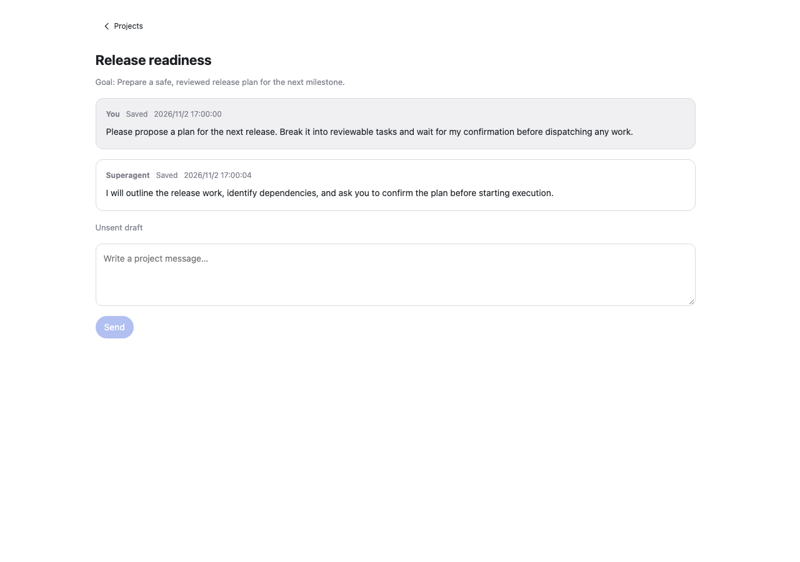
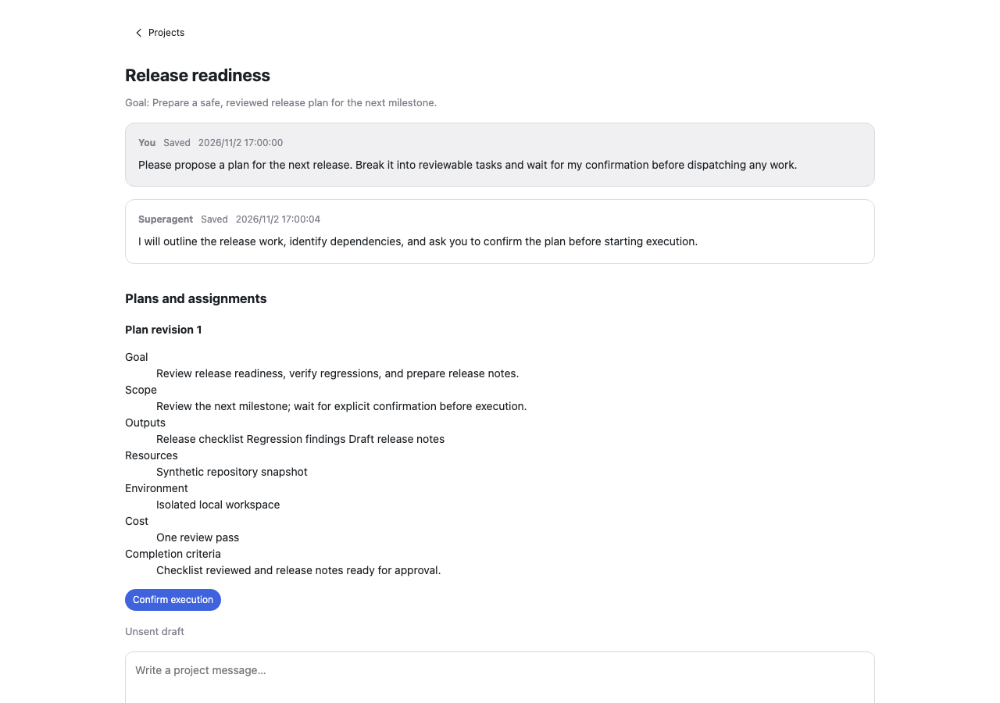

# Project conversation: visual evidence

Actual browser screenshots of the exported `ProjectConversation` React component, mounted under its real `PanelProvider`, using synthetic API responses. These are component captures, not mockups. The standalone harness does not include the DSH application shell and does not validate backend execution.

| Before | After |
| --- | --- |
|  |  |

The same release-readiness project, goal, two saved messages, timestamps, and pending plan are supplied to both revisions. The baseline component ignores the new `tasks` response property. The updated component shows “Plans and assignments”, “Plan revision 1”, all seven plan contract fields (goal, scope, outputs, resources, environment, cost, and completion criteria), and “Confirm execution”. Both pages are captured at the top of their scroll container. The expanded contract and confirmation button are readable within 1280 × 900; the composer continues below the After viewport.

A supplemental [confirmed-state screenshot](after-confirmed.png) renders the same component and plan with a synthetic authorization and pending assignment, showing “Run again”, “Revoke authorization”, and “Waiting for the T4 executor”. This is a separate seeded state, not evidence of clicking confirmation or a successful backend transition. Its PNG SHA-256 is `cd0eaebded5aa816d013069e51adb4fed39c14afa0ae5f6cc515d0973c975293`; [browser evidence](after-confirmed-browser-evidence.json) records its 1280 × 900 viewport and zero runtime exceptions.

## Revisions and fingerprints

- Before: `998b62cdc242232bad49ff8dea5dc930c07d167c`. The source was preserved with `git archive` before the component was edited. Baseline component Git blob: `86ba4a359065e55ee7bb8d7a2df7965b7117636e`.
- After: working tree based on `998b62cdc242232bad49ff8dea5dc930c07d167c`, identified as `998b62cdc242232bad49ff8dea5dc930c07d167c+working-tree:09744d9936cbedbe79828af35f5be0af362cb675`. There was no changed commit SHA at capture time. Updated component Git blob: `09744d9936cbedbe79828af35f5be0af362cb675`; component SHA-256: `2f4420c6343ae26402c092e6aac9f5edf89ea17fc93c9d77555c5ab44829c62f`.
- Before PNG SHA-256: `e8abb86a272bdafec921232a4f4d21fafbec238fe2d2d1948b1c9f40b0e853f3`.
- After PNG SHA-256: `3bdb93019434549a78dc7e6829b0fed47df74ec91a74d0fa03b33093f397a651`.

Complete captured source fingerprints are in [before-source-metadata.json](before-source-metadata.json) and [after-source-metadata.json](after-source-metadata.json). The changed source was copied into a temporary snapshot before the final After build. A later commit can be associated with this capture by comparing these fingerprints; the working-tree identifier above is not a commit SHA.

## Capture conditions and checks

- Microsoft Edge `156.0.4314.58`, installed locally, running headless with a separate temporary browser profile.
- Actual browser viewport: 1280 × 900 CSS pixels; device scale factor 1. PNG dimensions: 1280 × 900.
- Light color preference; explicitly seeded light `--dsw-alias-*` host design tokens; original component CSS unchanged. Host token values are visible in [build.mjs](build.mjs), and are harness values rather than tokens read from a live application.
- Time zone explicitly set to `Asia/Shanghai`; fixed synthetic timestamps. Browser locale was the installed browser default, as visible in the images.
- Original `PanelProvider`, API caller, polling hook, UI controls, and project CSS are bundled directly from each source snapshot. The English UI strings used here are extracted from each revision's own locale dictionary; unrelated computed dictionary entries are not needed by this scenario.
- `window.fetch` returns synthetic `Response` objects for the real caller's conversation and state requests. Both captures record the actual GET requests to `/orchestrator/api/projects/project-visual/conversation` and `/orchestrator/api/state`.
- Zero `Runtime.exceptionThrown` events in both captures. Browser text, viewport, API calls, and exception lists are recorded in [before-browser-evidence.json](before-browser-evidence.json) and [after-browser-evidence.json](after-browser-evidence.json).
- The archived baseline was captured before the component edits. Repeating it after adding the identical task seed to both harnesses produced the exact same Before PNG hash.
- The confirmation button is shown in the awaiting-confirmation state. These screenshots do not demonstrate a POST, authorization persistence, dispatch, or executor behavior.

Only temporary harness files and this ticket evidence directory were written by the capture agent. No new dependencies were installed. No production data or credentials were used. No runtime, deployment, or forbidden checkout changes were made, and no replacement web server was started.

## Reproduction

Run from this repository, with its existing dependencies installed. Node must provide the built-in `WebSocket` API; the existing project tooling and installed Edge were sufficient for these captures. [build.mjs](build.mjs) uses the repository's installed `tsdown`, React, and ReactDOM, with `config: false` so it does not run the normal project build configuration. [capture.mjs](capture.mjs) drives the isolated browser directly over the Chrome DevTools Protocol; no browser automation dependency is installed.

```bash
export EVIDENCE_REPO="$PWD"
export EVIDENCE_DIR="$(mktemp -d /tmp/plan-confirmation-evidence-repro.XXXXXX)"
mkdir -p "$EVIDENCE_DIR/before-source"
git archive 998b62cdc242232bad49ff8dea5dc930c07d167c src | tar -x -C "$EVIDENCE_DIR/before-source"
node docs/evidence/plan-confirmation-dispatch/build.mjs before
node docs/evidence/plan-confirmation-dispatch/capture.mjs before
node docs/evidence/plan-confirmation-dispatch/build.mjs after
node docs/evidence/plan-confirmation-dispatch/capture.mjs after
node docs/evidence/plan-confirmation-dispatch/build.mjs after-confirmed
node docs/evidence/plan-confirmation-dispatch/capture.mjs after-confirmed
shasum -a 256 "$EVIDENCE_DIR/before.png" "$EVIDENCE_DIR/after.png"
```

For an exact After reproduction, the source files in the current checkout must match [after-source-metadata.json](after-source-metadata.json). `SOURCE_DIR` can point the build at a separately preserved source snapshot. `EDGE_BIN` overrides the default macOS Edge executable path. The original capture used `/tmp/plan-confirmation-evidence`, with the baseline snapshot in `before-source` and the final refreshed After snapshot in `after-source-v2`.

The PNGs are repository artifacts. A PR in a fork can embed them using paths to this evidence directory at its head revision, for example:

```markdown


```

Replace `<PR-HEAD-SHA>` with the actual pushed revision. No GitHub attachment upload or PR publication was performed by the capture agent.
