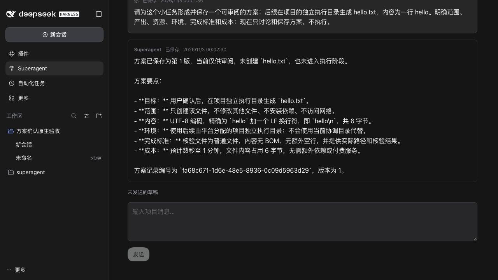
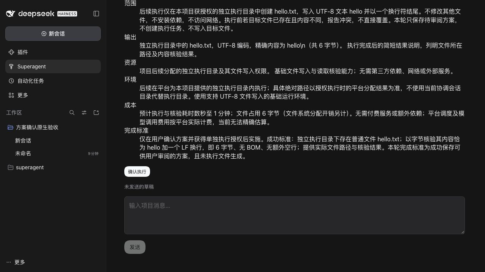
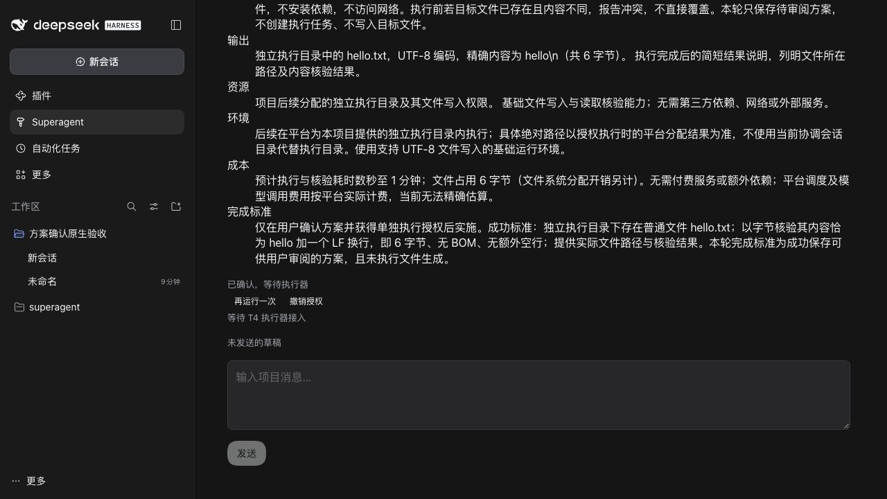

# T3 原生宿主验收

在真实 DSH 0.2.1-rc.5 与配置中的 gpt-6.1-sol 上，通过原生认证和 CUA 浏览器完成；两个隔离 profile 均关闭外部来源。

- 模型实际调用保存方案工具，生成一个待确认 Ticket。此时没有授权或 Assignment，也未生成目标文件。
- 浏览器点击确认，再以另一条消息重复确认。实际 DB 仍为一个 Ticket、一份授权、一个执行目标和一个 pending Assignment；授权保存实际确认消息及原始需求，等待原因为 `executor-unavailable`，没有启动 worker。
- Before 与 After 使用同一已保存项目、消息和待确认方案的 SQLite 一致性快照，消息指纹相同；Before 由 T2 代码读取该快照，仅用于界面对比，并不声称 T2 创建了方案。两张图都是完整 DSH 应用壳，非组件 harness。
- 两边均使用原生深色主题、1280×720 viewport，并将项目页面滚动到底部。完整字段已通过实际页面可访问性树核对。

| Before（T2） | After（T3 待确认） |
| --- | --- |
|  |  |

确认并重复确认后的实际界面：

截图与真实链路对应冻结快照 `f814e40da4ca69e11356b7b743eaa575b43d93b8`；基线 `bf12d02` 与 T2 合入 `998b62c` 的树相同。详情与指纹见 [evidence.json](evidence.json)。后续澄清持久化、提示词及文案修复仍须按最终 HEAD 复审/复测；本记录不替代这些检查。
