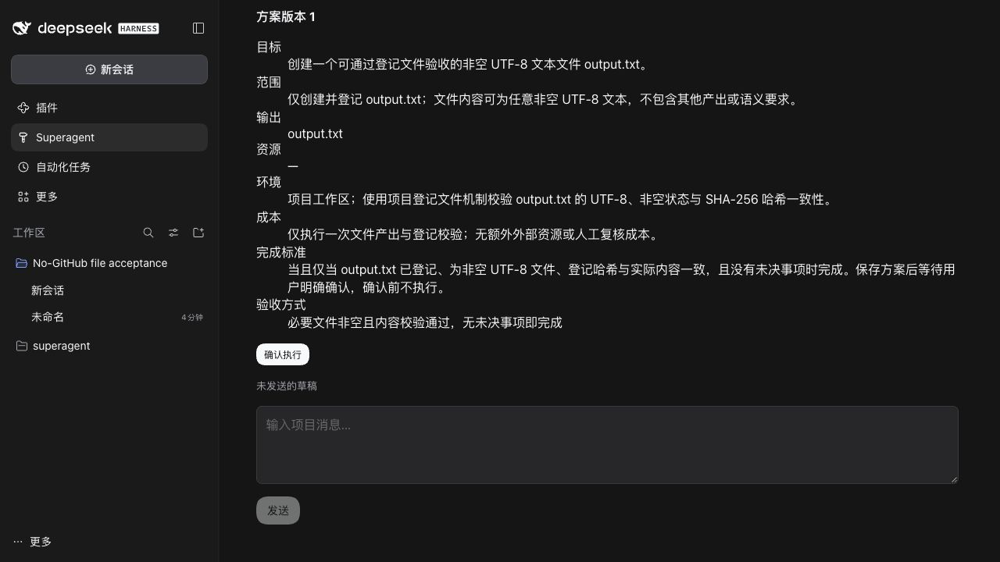
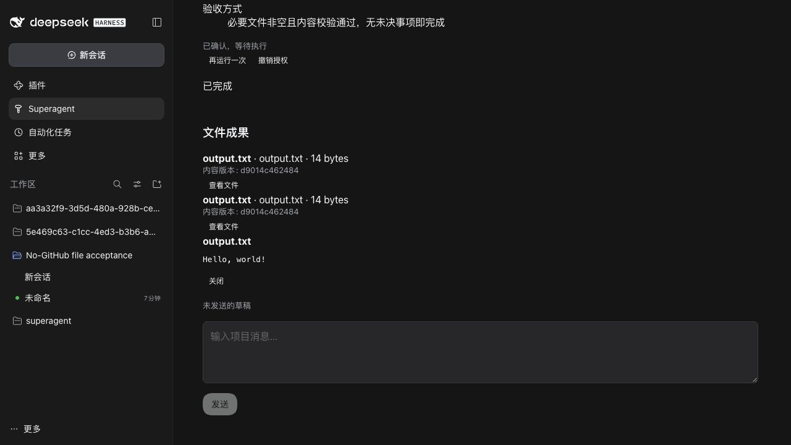

# T4 原生文件闭环证据

真实 DSH0.2.1-rc.5、已配置的 gpt-6.1-sol、原生认证与 CUA 浏览器。隔离 profile 的 GitHub repository/agent 为空，Feishu 为 null，两个来源均关闭。

用户明确选择仅需文件结构检查的方案：唯一 output.txt，任意非空 UTF-8 内容，登记/哈希一致且无未决事项即可完成，不含内容语义要求。保存后无授权或 worker；原生页面展示完整方案及验收方式，点击一次确认后生成独立 Session/workspace/cwd 和准备证据，worker 实际登记14字节 `Hello, world!` 加换行，磁盘SHA-256与内容版本一致，报告被引擎接受并完成。

再由用户明确要求 rerun，在同一 Ticket 创建第二个目标。随后取消协调会话：原生协调 turn 于19:33:53.799Z aborted，应用输入保持error；第二个 worker 于19:34:17.979Z独立提交ready并完成，两个成果均校验通过。没有借coordinator最后回复判断完成。

原生页面的“查看文件”可显示实际成果内容。以下图片为同一实际流程确认前和成果后的状态，不是旧代码/新代码的同状态对比，也不是组件mock。

| 确认前 | 成果与预览 |
| --- | --- |
|  |  |

捕获构建为冻结提交 `3b63b31f32ef2ace78ffe41e38d6ed262fa6a43d`，原生暗色、1280×720。详情及指纹见 [evidence.json](evidence.json)。执行快照恢复等后续修复须按最终HEAD另行复审与必要重测；这里不把早期成功冒充所有后续检查。registered-files证明已声明的文件检查，语义验收另用版本化独立结论。
